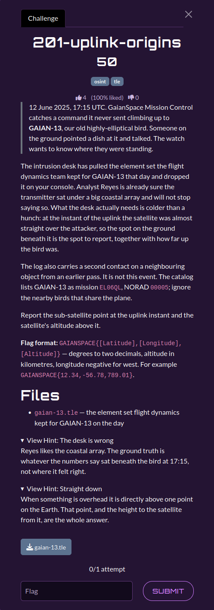

# 201-uplink-origins

| | |
|---|---|
| **Category** | 02 — Echoes of Espionage |
| **Points** | 50 |

## Description

The flight-dynamics team captured a TLE for GAIAN-13 (NORAD `00005`). At **2025-06-12 17:15:00 UTC**, determine the sub-satellite latitude, longitude, and WGS-84 altitude to two decimals.

**Flag format:** `GAIANSPACE{...}`

**Attachments:** 



## Solution

### Steps

1. Read the two TLE lines from `gaian-13.tle` and verify that the satellite catalog number is `5`.
2. Propagate the orbit to the specified UTC instant using SGP4. The returned position is in **TEME**, not Earth-fixed coordinates.
3. Rotate TEME into an approximate Earth-fixed frame using Vallado's GMST expression.
4. Convert the resulting Cartesian coordinates to geodetic WGS-84 latitude, longitude and altitude. Use the ellipsoid's flattening, not a fixed spherical Earth radius.
5. Round the three values to two decimal places.

### Reproduction

The supplied solver is [`scripts/201.py`](./scripts/201.py). Required dependencies: `sgp4`.

From the challenge input directory (`challenges/`):

```bash
`python3 ../scripts/201.py`
```

The code linked above is the solver **provided in the attached category archive**. It is the primary implementation referenced by this write-up.

Expected relevant output:

```text
Latitude:   26.46
Longitude: -98.64
Altitude:  3296.64 km
FLAG: GAIANSPACE{26.46,-98.64,3296.64}
```

## Flag

```text
GAIANSPACE{26.46,-98.64,3296.64}
```
