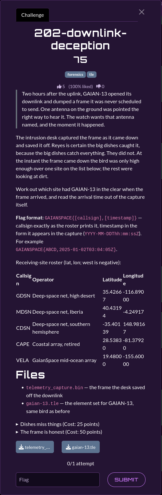

# 202-downlink-deception

| | |
|---|---|
| **Category** | 02 — Echoes of Espionage |
| **Points** | 75 |

## Description

A captured GAIAN-13 downlink includes a reception timestamp. Identify the ground station capable of receiving the downlink and report its callsign together with the timestamp.

**Flag format:** `GAIANSPACE{<callsign>,<UTC timestamp>}`

**Attachments:** `gaian-13.tle`, `telemetry_capture.bin`



## Solution

### Steps

**1. Extract the downlink timestamp**

Inspect `telemetry_capture.bin` and locate the ASCII UTC timestamp associated with the `GSTM` and `GAIAN-13` fields:

```text
2025-06-12T19:15:00Z
```

The original `scripts/202.py` only computes station elevation angles; it does not extract the timestamp or print the complete flag. The updated `scripts/202_fixed.py` performs both operations.

**2. Propagate the satellite orbit**

Load `gaian-13.tle` with Skyfield, propagate GAIAN-13 to the captured timestamp, and calculate the topocentric elevation angle from each candidate ground station using WGS-84 coordinates.

**3. Compare candidate stations**

| Callsign | Elevation | Above geometric horizon |
|---|---:|---|
| GDSN | +2.7620° | Yes |
| MDSN | −54.7217° | No |
| CDSN | −22.5975° | No |
| CAPE | −21.9414° | No |
| **VELA** | **+68.1723°** | **Yes** |

VELA has by far the highest elevation. GDSN is technically above the geometric horizon, so a simple elevation `> 0°` test cannot uniquely establish VELA. The selection is consistent with the challenge's *high enough* reception clue; an explicit elevation mask was not provided.

**4. Construct the flag**

Combine the selected station callsign with the UTC timestamp extracted from the capture.

### Reproduction

The corrected solver is [`scripts/202_fixed.py`](./scripts/202_fixed.py), which uses the supplied TLE and binary capture rather than hardcoding the timestamp or selected station.

Install the dependency:

```bash
python3 -m pip install skyfield
```

Run from the challenge directory:

```bash
python3 scripts/202_fixed.py \
    --capture challenges/telemetry_capture.bin \
    --tle challenges/gaian-13.tle
```

Expected output:

```text
Capture timestamp: 2025-06-12T19:15:00Z
GDSN: elevation=+2.7620 deg
MDSN: elevation=-54.7217 deg
CDSN: elevation=-22.5975 deg
CAPE: elevation=-21.9414 deg
VELA: elevation=+68.1723 deg
Note: GDSN is also above the geometric horizon; the problem implies
      an unspecified minimum elevation / usable-link criterion.
FLAG: GAIANSPACE{VELA,2025-06-12T19:15:00Z}
```

### Exploit Code

- [`scripts/202_fixed.py`](./scripts/202_fixed.py) — timestamp extraction, orbital propagation, station ranking, and flag construction.
- [`scripts/202.py`](./scripts/202.py) — original elevation-only analysis retained for reference.

## Flag

```text
GAIANSPACE{VELA,2025-06-12T19:15:00Z}
```

