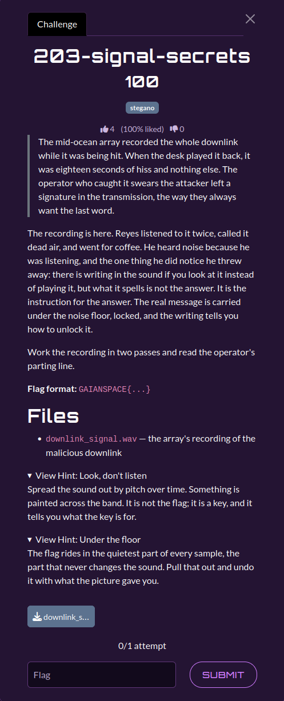

# 203-signal-secrets

| | |
|---|---|
| **Category** | 02 — Echoes of Espionage |
| **Points** | 100 |

## Description

An eighteen-second WAV appears to be noise. One message is visible in the spectrogram and instructs how to decode a second, lower-level message.

**Flag format:** `GAIANSPACE{...}`

**Attachments:** 



## Solution

### Steps

1. Inspect `downlink_signal.wav` (mono, 16 kHz, 16-bit PCM) in a spectrogram. The writing reads **`xor key = nimbus`**. It is an instruction, not the flag.
2. Read the least-significant bit of each signed PCM sample and pack consecutive bits MSB first.
3. XOR the resulting bytes with the repeating ASCII key `nimbus`. Test its six possible byte alignments; the correct alignment begins at offset **1**.
4. Search the decoded stream for the `GAIANSPACE{...}` envelope.

### Reproduction

The supplied solver is [`scripts/203.py`](./scripts/203.py). Required dependencies: `numpy`, `scipy`.

From the challenge input directory (`challenges/`):

```bash
`python3 ../scripts/203.py`
```

The code linked above is the solver **provided in the attached category archive**. It is the primary implementation referenced by this write-up.

Expected relevant output:

```text
Key offset: 1
FLAG: GAIANSPACE{tw0_l4yer_d0wnlink}
```

## Flag

```text
GAIANSPACE{tw0_l4yer_d0wnlink}
```
