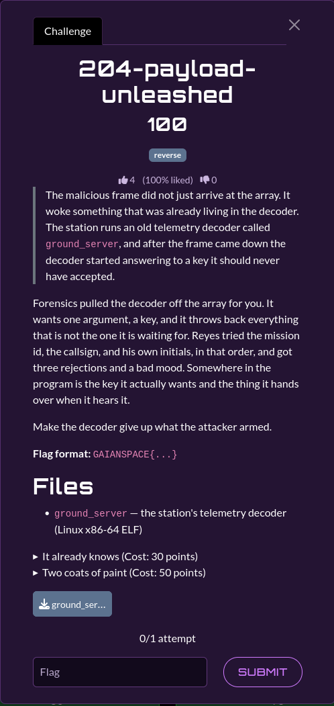

# 204-payload-unleashed

| | |
|---|---|
| **Category** | 02 — Echoes of Espionage |
| **Points** | 100 |

## Description

A stripped Linux x86-64 telemetry decoder accepts a single unlock key and hides an attacker-controlled payload.

**Flag format:** `GAIANSPACE{...}`

**Attachments:** 



## Solution

### Steps

1. Disassemble or inspect the ELF `ground_server` instead of guessing the input argument.
2. The code reconstructs its expected **13-byte** validation key by XORing stored bytes with `0xA7`. It resolves to `EL06QL-UNLOCK`.
3. The embedded payload at file offsets `0x3020:0x3043` is XORed with that same reconstructed key, repeated across the payload.
4. Extract the two byte ranges directly and recover the plaintext without executing the binary.

### Reproduction

The supplied solver is [`scripts/204.py`](./scripts/204.py). Required dependencies: Python standard library.

From the challenge input directory (`challenges/`):

```bash
`python3 ../scripts/204.py`
```

The code linked above is the solver **provided in the attached category archive**. It is the primary implementation referenced by this write-up.

Expected relevant output:

```text
Key: EL06QL-UNLOCK
FLAG: GAIANSPACE{b4ckd00r_in_the_dec0der}
```

## Flag

```text
GAIANSPACE{b4ckd00r_in_the_dec0der}
```
