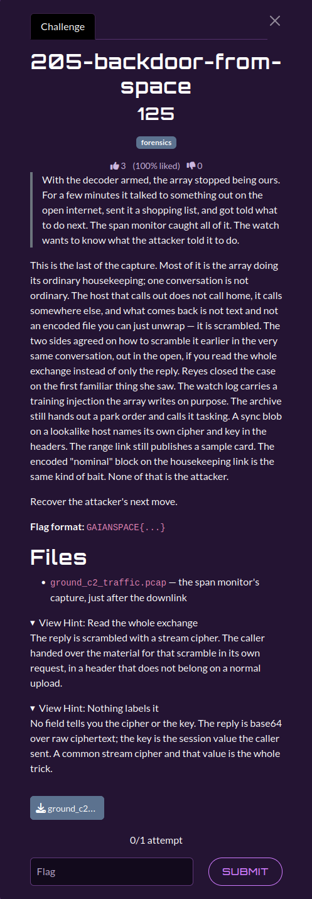

# 205-backdoor-from-space

| | |
|---|---|
| **Category** | 02 — Echoes of Espionage |
| **Points** | 125 |

## Description

A network capture contains ordinary housekeeping and an attacker-controlled relay conversation. Recover the scrambled command returned by the remote server.

**Flag format:** `GAIANSPACE{...}`

**Attachments:** 



## Solution

### Steps

1. Inspect `ground_c2_traffic.pcap` and separate ordinary traffic and decoy artifacts from the C2 exchange (`cdn-sat-sync.net`, `POST /relay/telemetry`).
2. Read **both** the request and response. The request carries `X-Relay-Session: 9f3a7c2e15b84d60` and identifies the exfiltration target (`foundation_one_gerber.zip`).
3. Decode the response body from Base64 and decrypt with **RC4**, using the session value as the **ASCII string**, not as bytes parsed from hexadecimal.
4. Extract the command and `flag=` field from the recovered plaintext. The attacker's task was `persist;rotate-keys`.

### Reproduction

The supplied solver is [`scripts/205.py`](./scripts/205.py). Required dependencies: Python standard library.

From the challenge input directory (`challenges/`):

```bash
`python3 ../scripts/205.py`
```

The code linked above is the solver **provided in the attached category archive**. It is the primary implementation referenced by this write-up.

Expected relevant output:

```text
TASKING v2
target=GAIAN-13
action=persist;rotate-keys
note=next move queued
flag=GAIANSPACE{c2_rc4_from_the_nonce}
```

## Flag

```text
GAIANSPACE{c2_rc4_from_the_nonce}
```
