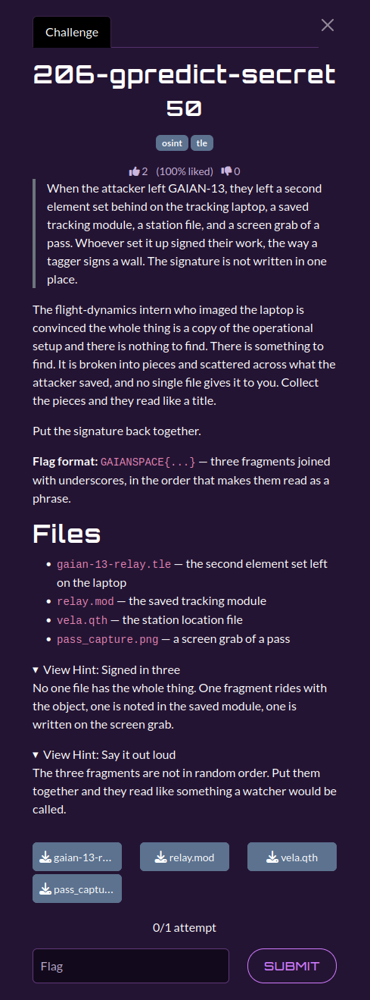

# 206-gpredict-secret

| | |
|---|---|
| **Category** | 02 — Echoes of Espionage |
| **Points** | 50 |

## Description

An attacker left behind a Gpredict tracking module, a secondary TLE, a ground-station QTH file, and a pass screenshot. Three pieces of a signature must be collected in phrase order.

**Flag format:** `GAIANSPACE{...}`

**Attachments:** 



## Solution

### Steps

1. Read `gaian-13-relay.tle`: the satellite title includes `;tag:w4tcher`.
2. Read `relay.mod`: the operator comment contains `relay-token=0f`.
3. Inspect `pass_capture.png`: the **Footprint** display includes `note: the_sky`.
4. Cross-check `vela.qth` for the VELA station configuration. It verifies the context rather than contributing a phrase fragment.
5. Combine the three fragments in the order **`w4tcher`**, **`0f`**, **`the_sky`**. Preserve literal digits and underscores.

### Reproduction

The supplied solver is [`scripts/206.py`](./scripts/206.py). Required dependencies: `pillow`, `pytesseract`, Tesseract OCR.

From the challenge input directory (`challenges/`):

```bash
`python3 ../scripts/206.py`
```

**Path note:** The supplied `206.py` resolves input files relative to its own `scripts/` directory, whereas this repository stores inputs in `challenges/`. Copy the four input files into `scripts/` (or adjust `BASE_DIR`) before running.

The code linked above is the solver **provided in the attached category archive**. It is the primary implementation referenced by this write-up.

Expected relevant output:

```text
TLE        : w4tcher
Module     : 0f
Screenshot : the_sky
FLAG: GAIANSPACE{w4tcher_0f_the_sky}
```

## Flag

```text
GAIANSPACE{w4tcher_0f_the_sky}
```
