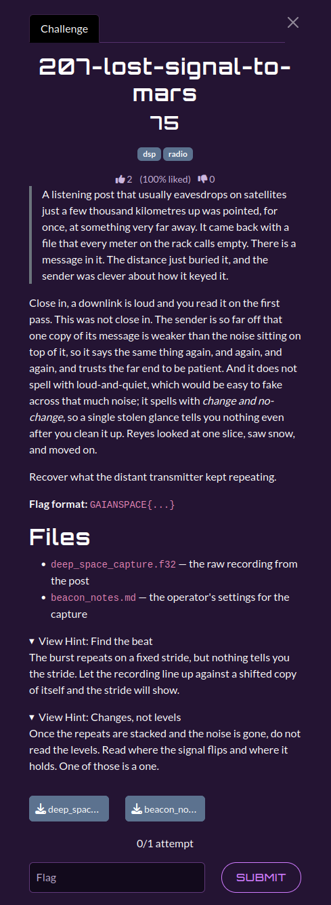

# 207-lost-signal-mars

| | |
|---|---|
| **Category** | 02 — Echoes of Espionage |
| **Points** | 75 |

## Description

A distant transmitter repeatedly sends a weak signal using differential encoding. Recover the text by averaging repetitions and detecting symbol changes.

**Flag format:** `GAIANSPACE{...}`

**Attachments:** 



## Solution

### Steps

1. Read little-endian float32 samples from `deep_space_capture.f32` and the symbol settings from `beacon_notes.md`.
2. Average **four samples per symbol**. The capture contains **115,600 symbols**, arranged as **400 repeats × 289 symbols**.
3. Average the aligned repeats to improve SNR.
4. Turn averaged amplitudes into two levels, then decode bits by testing whether each level differs from its predecessor (`change = 1`).
5. Pack the recovered bits MSB first and locate the flag. The first decoded byte can contain a non-printable prefix and is not part of the flag.

### Reproduction

The supplied solver is [`scripts/207.py`](./scripts/207.py). Required dependencies: `numpy`.

From the challenge input directory (`challenges/`):

```bash
`python3 ../scripts/207.py`
```

The code linked above is the solver **provided in the attached category archive**. It is the primary implementation referenced by this write-up.

Expected relevant output:

```text
Samples:     462400
Symbols:     115600
Burst size:  289
Repetitions: 400
FLAG: GAIANSPACE{diff_enc0ded_and_buried}
```

## Flag

```text
GAIANSPACE{diff_enc0ded_and_buried}
```
