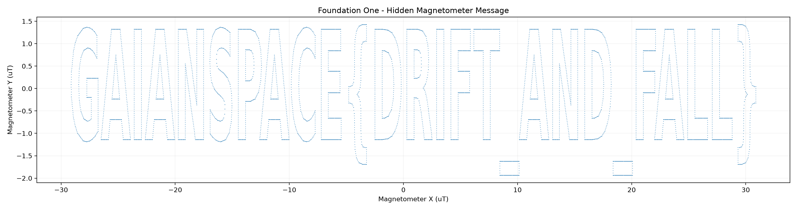

# 307-descent-diary

| | |
|---|---|
| **Category** | 03 — Orbital Oops at Mission Control |
| **Points** | 75 |

## Description

Foundation One logged every sensor it had, all the way down. The recovery team pulled the card after landing and handed over the whole diary of the fall. The flight lead wants to know if the CanSat recorded anything it was not supposed to.

The barometer tells a tidy story — a clean fall from a kilometre up to a hard stop in the dirt — and that tidy story is what everyone keeps staring at. It is not where the surprise is. The CanSat carried more than one instrument, and one of them was not watching the sky at all. Let that instrument draw its own picture and it stops looking like noise.

Read what the descent diary was hiding.

**Flag format:** `GAIANSPACE{...}`

**Attachments:**
- `descent_log.csv` — the full sensor diary of the descent

## Hints

Two hints were released during the event:

1. **Not the barometer** — The altitude curve is a distraction. Look at the sensor whose two channels mean nothing on their own.
2. **Let it draw** — Those two channels are coordinates, not a time series. Plot one against the other and stop reading them as numbers.

## Solution

### Analysis

The descent diary contains time-series measurements, including magnetometer X and Y in microteslas. Plotting these channels *against time* makes them look like ordinary sensor noise; a direct plot of `mag_y_uT` against `mag_x_uT` exposes the hidden lettering.

The code uses a scatter plot instead of joining chronological points, since connecting adjacent sensor samples would obscure the geometric arrangement. The message is read visually, not decoded from an ASCII string in the CSV:

```text
GAIANSPACE{DRIFT_AND_FALL}
```

### Reproduction

Install the plotting dependencies and place `descent_log.csv` next to `307.py`:

```bash
python3 -m pip install pandas matplotlib
python3 307.py
```

The solver saves [**`flag.png`**](./images/flag.png) and normally displays the plot in an interactive matplotlib environment. It prints the output filename but does **not** print the flag, because the final decoding step is reading the scatter plot itself.

If running headlessly, use a noninteractive backend:

```bash
MPLBACKEND=Agg python3 307.py
```

The image is generated from the original measurements. No precomputed character coordinates or known flag string are required.

### Solver Code

```python
#!/usr/bin/env python3
"""Visualize a hidden message in two magnetometer channels."""

# Dependencies:
#   python3 -m pip install pandas matplotlib

import pandas as pd
import matplotlib.pyplot as plt

df = pd.read_csv("descent_log.csv")

# Plot magnetometer readings as XY coordinates.
fig, ax = plt.subplots(figsize=(17, 4.5))

ax.scatter(
    df["mag_x_uT"],
    df["mag_y_uT"],
    s=0.8,
    linewidths=0,
)

ax.set_xlabel("Magnetometer X (uT)")
ax.set_ylabel("Magnetometer Y (uT)")
ax.set_title("Foundation One - Hidden Magnetometer Message")
ax.grid(alpha=0.15)

plt.tight_layout()
plt.savefig("307_flag.png", dpi=200)
print("Saved magnetometer scatter plot to 307_flag.png")
# Reading the text from the image is the final, visual step.
plt.show()
```

## Flag



```text
GAIANSPACE{DRIFT_AND_FALL}
```
