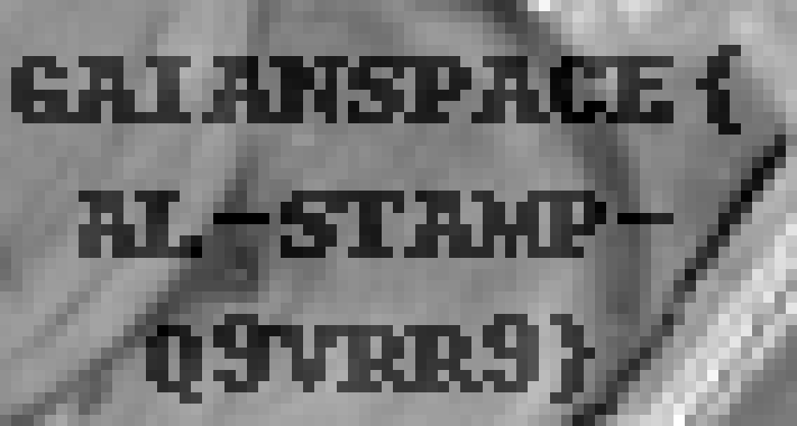

# 121-channel-hop

| | |
|---|---|
| **Category** | 12 — Spectral Forensics |
| **Points** | 100 |

## Description

05:40, the Babb farm outside Mezőhegyes. The Johnripper fleet is fuelled and waiting for this morning's field map.

Babb Ceresné farms corn on the plain. Every clear morning, GaianSpace AgriLink drops a fresh tile of the farm from the last satellite pass onto the LoRa mast by the grain dryer, and the tractors set their fertiliser rates from it.

This morning the tile came in on time. The tablet in the yard shows the farm in true colour: the north block, the pivots, the poplar line along the road, exactly as they look from the dryer. The tractors refused it anyway. Every cab screen says the same thing: *map integrity: unverified.*

AgriLink support won't open a ticket without the tile's delivery stamp. Their welcome letter promises that every tile carries one. Babb has looked at the tablet three times and can't find it.

The mast keeps a journal of everything it hears.

Find the delivery stamp.

**Flag format:** `GAIANSPACE{...}`

**Attachments:**

- `mast_rx_0540.log` — the mast's journal of this morning's pass
- `agrilink_welcome.txt` — the letter AgriLink sent when the farm signed up; some of it is out of date

Contains modified Copernicus Sentinel data 2025.

## Hints

Two hints were released during the event:

1. **The tablet shows three** — The tablet only shows what a person can see. The pass carried more than that.
2. **Where the corn is loudest** — The stamp sits in the part of the light where healthy corn shines brightest, and the tablet never looks there.

## Solution

### Steps

1. Parse the LoRa mast journal and validate received image-row packets.
2. Reassemble the five Sentinel-2 bands B02, B03, B04, B08, and B11 by channel and row index.
3. Do not rely on the tablet's RGB composite: the delivery stamp is embedded in B08 (near infrared).
4. Crop and enlarge the B08 stamp area and read its three lines in order. This solver intentionally saves an image rather than printing the flag.

### Reproduction

Run the original solver from its challenge directory with its original input files:

```bash
python3 121.py
```

Expected relevant output:

```text
Accepted packets: 641
Unique image rows: 639
Duplicate rows: 0
Missing rows: [(4, 100)]
Metadata: tile=0704 site=BABB-N date=2025-07-04 src=S2 L2A gsd=10m px=128x128 ch=B02,B03,B04,B08,B11 scale=refl*400
Saved: 121_output/delivery_stamp.png
Read the three lines in the saved B08 image and join them without newlines.
```

The flag is displayed visually in the generated `121_output/delivery_stamp.png`; the script does not print it. The stamp was visually transcribed from the generated image as `GAIANSPACE{AL-STAMP-Q9VRR9}`. The script writes the image rather than using OCR; the final transcription is a visual step.
### Exploit Code

```python
#!/usr/bin/env python3
# Dependencies (install if needed):
#   python3 -m pip install numpy Pillow
"""Recover the AgriLink delivery stamp from the LoRa mast journal."""

import argparse
import re
from pathlib import Path

import numpy as np
from PIL import Image, ImageEnhance

PACKET_PATTERN = re.compile(
    r"^\S+\s+\S+\s+-?\d+\s+[+-]?\d+(?:\.\d+)?\s+"
    r"(OK|BAD)\s+(\d+)\s+([0-9a-fA-F]+)\s*$"
)
BANDS = ("B02", "B03", "B04", "B08", "B11")
IMAGE_SIZE = 128


def read_packets(path: Path) -> tuple[np.ndarray, list[tuple[int, int]], str]:
    cube = np.zeros((len(BANDS), IMAGE_SIZE, IMAGE_SIZE), dtype=np.uint8)
    received: set[tuple[int, int]] = set()
    duplicate_rows: list[tuple[int, int]] = []
    metadata = ""
    count = 0

    for line_number, line in enumerate(path.read_text(encoding="utf-8").splitlines(), 1):
        if not line or line.startswith("#"):
            continue
        match = PACKET_PATTERN.match(line)
        if match is None:
            raise ValueError(f"Invalid log line {line_number}")
        crc_status, length_text, hex_text = match.groups()
        payload = bytes.fromhex(hex_text)
        if len(payload) != int(length_text, 10):
            raise ValueError(f"Length mismatch on line {line_number}")
        if crc_status != "OK":
            continue
        if len(payload) < 6 or payload[:5] != b"AL\x02\x04\x07":
            raise ValueError(f"Unexpected frame header on line {line_number}")
        packet_type = payload[5]
        count += 1
        if packet_type == ord("M"):
            metadata = payload[6:].decode("ascii")
        elif packet_type == ord("D"):
            if len(payload) != 8 + IMAGE_SIZE:
                raise ValueError(f"Unexpected image packet size on line {line_number}")
            channel = int(payload[6])
            row_index = int(payload[7])
            if not (0 <= channel < len(BANDS) and 0 <= row_index < IMAGE_SIZE):
                raise ValueError(f"Invalid channel/row on line {line_number}")
            key = (channel, row_index)
            if key in received:
                if cube[channel, row_index].tobytes() != payload[8:]:
                    raise ValueError(f"Conflicting duplicate at channel={channel}, row={row_index}")
                duplicate_rows.append(key)
            else:
                cube[channel, row_index] = np.frombuffer(payload[8:], dtype=np.uint8)
                received.add(key)
        elif packet_type != ord("E"):
            raise ValueError(f"Unexpected packet type {packet_type:#x}")

    missing = [(channel, row) for channel in range(len(BANDS))
               for row in range(IMAGE_SIZE) if (channel, row) not in received]
    print(f"Accepted packets: {count}")
    print(f"Unique image rows: {len(received)}")
    print(f"Duplicate rows: {len(duplicate_rows)}")
    print(f"Missing rows: {missing}")
    print(f"Metadata: {metadata}")
    if any(channel == 3 for channel, _ in missing):
        raise ValueError("The B08 band is incomplete")
    return cube, missing, metadata


def main() -> None:
    parser = argparse.ArgumentParser(description=__doc__)
    parser.add_argument("log", nargs="?", type=Path, default=Path("mast_rx_0540.log"))
    parser.add_argument("--output", type=Path, default=Path("121_output"))
    args = parser.parse_args()

    cube, _, _ = read_packets(args.log)
    args.output.mkdir(parents=True, exist_ok=True)

    for channel, band in enumerate(BANDS):
        image = Image.fromarray(cube[channel], mode="L")
        image.save(args.output / f"{band}_raw.png")
        image.resize((768, 768), Image.Resampling.NEAREST).save(
            args.output / f"{band}_enlarged.png"
        )

    # The delivery stamp is visible in the B08 (near-infrared) channel.
    b08 = Image.fromarray(cube[3], mode="L")
    crop = b08.crop((30, 44, 101, 82))
    crop = crop.resize((994, 532), Image.Resampling.NEAREST)
    enhanced = ImageEnhance.Contrast(crop).enhance(2.2)
    enhanced.save(args.output / "delivery_stamp.png")

    print(f"Saved: {args.output / 'delivery_stamp.png'}")
    print("Read the three lines in the saved B08 image and join them without newlines.")


if __name__ == "__main__":
    main()
```

## Flag



```
GAIANSPACE{AL-STAMP-Q9VRR9}
```
