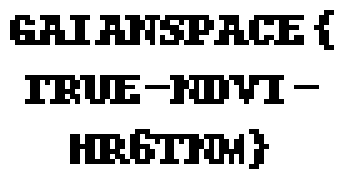

# 122-true-color-is-a-lie

| | |
|---|---|
| **Category** | 12 — Spectral Forensics |
| **Points** | 125 |

## Description

06:55. The second pass. This time the tractors took the map, and the spreaders are already rolling.

The new tile looks perfect on the tablet: the lagoons by the treatment works, the stubble, the edge of the pivots. But the lead Johnripper has marked every green thing on the tile as dead and is spreading at its maximum rate. Babb walked the pivots an hour ago. The corn isn't dead.

After the first pass, the co-op lent the farm a cheap SDR, and it has been sitting next to the mast since then, keeping every burst it hears on the AgriLink frequency. AgriLink says this pass was one transmission. The SDR doesn't agree.

There's more. Since last night AgriLink sends the channels without names, "to save airtime", and the mast puts them in order from its band-order file. Someone rewrote that file at 02:13 from a remote session nobody at the farm remembers opening.

Find out what AgriLink really sent.

**Flag format:** `GAIANSPACE{...}`

**Attachments:**

- `coop_sdr_0655.sigmf-data` — the co-op SDR's bursts from the pass (too large to attach: download it from [Hugging Face](https://huggingface.co/datasets/GaianSpace/ctf-2026-120/tree/main/122))
- `coop_sdr_0655.sigmf-meta` — the SDR's metadata for that file
- `band_order.conf` — the mast's band-order file, as it is now
- `tablet_0655.png` — what the tablet showed

Contains modified Copernicus Sentinel data 2025.

## Solution

### Steps

1. Decode the SDR bursts and verify their CRCs. Separate the two RF populations at the largest gap in **log received power**; use their reported CFO values as a diagnostic cross-check, not as the clustering variable.
2. Reassemble the image cube using the actual radio packet order rather than the altered band-order configuration.
3. Compare the original red channel against the later replacement; 586 red pixels were overwritten.
4. Recover the bitmap stencil from the changed pixels, then decode the three text lines with the exact bitmap font.
5. Cross-check NIR/red combinations using NDVI to understand why the tablet's true-color view was misleading.

The captured packets were independently re-decoded from the original `coop_sdr_0655.sigmf-data`; all **781/781** decoded packets passed their application CRC checks. The two received-power groups, which also have distinct median CFOs, contain different packet counts (642 vs. 139), so the later transmission is a partial replacement, not an entirely separate full cube. The red-channel comparison finds **586** overwritten pixels.

### Reproduction

Run the solver with the original SigMF data and metadata:

```bash
python3 122.py
```

Expected relevant output:

```text
Decoded and CRC-verified: 781/781
Metadata: tile=0705 site=BABB-N date=2025-07-04 src=S2 L2A gsd=10m px=128x128 ch=5 order=rx-cal scale=refl*400
RF group 0: packets=642, image rows=640, median CFO=-1342.8 Hz
RF group 1: packets=139, image rows=139, median CFO=-7934.6 Hz
Red pixels replaced: 586
Exact bitmap-font match: GAIANSPACE{ / TRUE-NDVI- / HR6TNM}
Recovered text: GAIANSPACE{TRUE-NDVI-HR6TNM}
FLAG: GAIANSPACE{TRUE-NDVI-HR6TNM}
```

### Exploit Code

```python
#!/usr/bin/env python3
# Dependencies (install if needed):
#   python3 -m pip install numpy Pillow
"""Reproduce the GaianSpace CTF 122 radio and image recovery.

Dependencies: numpy, Pillow. No radio transmission or external service is used.
The decoder is configured for the observed SF7/BW500k capture, not arbitrary LoRa.
The bit pipeline was checked against https://github.com/jkadbear/LoRaPHY.
"""
from __future__ import annotations
import argparse
import binascii
import json
import math
from pathlib import Path
import numpy as np
from PIL import Image, ImageDraw, ImageFont

HEADER_CHECK = np.array([
 [1,1,1,1,0,0,0,0,0,0,0,0],
 [1,0,0,0,1,1,1,0,0,0,0,1],
 [0,1,0,0,1,0,0,1,1,0,1,0],
 [0,0,1,0,0,1,0,1,0,1,1,1],
 [0,0,0,1,0,0,1,0,1,1,1,1],
], dtype=np.int64)


def parity(n: int, positions: tuple[int, ...]) -> int:
    result = 0
    for bit in positions:
        result ^= (int(n) >> (int(bit) - 1)) & 1
    return int(result)


def ham_encode(n: int, width: int) -> int:
    value = int(n)
    if width == 5:
        return value | (parity(n, (1,2,3,4)) << 4)
    value |= parity(n, (1,2,3)) << 4
    value |= parity(n, (2,3,4)) << 5
    if width >= 7:
        value |= parity(n, (1,2,4)) << 6
    if width == 8:
        value |= parity(n, (1,3,4)) << 7
    return int(value)


TABLES = {w: tuple(ham_encode(n, w) for n in range(16)) for w in range(5,9)}


def ham_decode(words: list[int], width: int) -> list[int]:
    if width <= 6:
        return [int(w) & 15 for w in words]
    return [int(np.argmin([(int(w) ^ int(c)).bit_count() for c in TABLES[width]]))
            for w in words]


def deinterleave(symbols: list[int], ppm: int) -> list[int]:
    words = [0] * ppm
    for k, symbol in enumerate(symbols):
        for j in range(ppm):
            words[j] |= ((int(symbol) >> ((j-k) % ppm)) & 1) << int(k)
    return words


def header(symbols: np.ndarray) -> tuple[int, int, int]:
    reduced = [int(s) // 4 for s in symbols[:8]]
    gray = [s ^ (s >> 1) for s in reduced]
    nib = ham_decode(deinterleave(gray, 5), 8)
    plen = int(nib[0]) * 16 + int(nib[1])
    cr = int(nib[2]) >> 1
    has_crc = int(nib[2]) & 1
    bits = np.array([(int(n) >> b) & 1 for n in nib[:3] for b in (3,2,1,0)], dtype=np.int64)
    check = np.array([int(nib[3]) & 1] + [(int(nib[4]) >> b) & 1 for b in (3,2,1,0)], dtype=np.int64)
    if cr not in (1,2,3,4) or not np.array_equal(check, (HEADER_CHECK @ bits) % 2):
        raise ValueError(f"Invalid explicit header: {nib}")
    if has_crc != 1:
        raise ValueError("Missing payload CRC")
    return plen, cr, has_crc


def payload_crc(data: bytes) -> int:
    if len(data) < 2:
        return int(data[0]) if data else 0
    return int(binascii.crc_hqx(data[:-2], 0)) ^ int(data[-1]) ^ (int(data[-2]) << 8)


def whitening(length: int) -> bytes:
    state = 255
    output = bytearray()
    for _ in range(length):
        output.append(int(state))
        feedback = ((state >> 7) ^ (state >> 5) ^ (state >> 4) ^ (state >> 3)) & 1
        state = ((state << 1) | feedback) & 255
    return bytes(output)


def decode_bytes(symbols: np.ndarray) -> tuple[bytes, int]:
    plen, cr, has_crc = header(symbols)
    needed = 8 + (4+cr) * int(math.ceil(float(2*plen+4*has_crc) / 7.0))
    if int(symbols.size) < needed:
        raise ValueError("Insufficient data symbols")
    nib: list[int] = []
    for offset in range(8, needed, 4+cr):
        reduced = [(int(s)-1) % 128 for s in symbols[offset:offset+4+cr]]
        gray = [s ^ (s >> 1) for s in reduced]
        nib.extend(ham_decode(deinterleave(gray, 7), 4+cr))
    packed = bytes(int(nib[i]) | (int(nib[i+1]) << 4) for i in range(0, len(nib)-1, 2))
    if len(packed) < plen + 2:
        raise ValueError("Decoded payload is truncated")
    data = bytes(a ^ b for a, b in zip(packed[:plen], whitening(plen)))
    stored = int.from_bytes(packed[plen:plen+2], "little")
    actual = payload_crc(data)
    if stored != actual:
        raise ValueError(f"CRC failure: stored={stored:04X}, calculated={actual:04X}")
    return data, actual


class Receiver:
    def __init__(self, fs: float) -> None:
        self.fs = float(fs)
        if int(round(fs / 500000.0)) != 4:
            raise ValueError("Expected approximately four samples per chip")
        n = np.arange(512, dtype=np.float64)
        self.up = np.exp(1j*np.pi*(n*n/2048.0-n/4.0))

    def peaks(self, blocks: np.ndarray, reference: np.ndarray, pad: int = 8) -> tuple[np.ndarray, np.ndarray]:
        ft = np.abs(np.fft.fft(blocks*reference, n=512*pad, axis=-1))
        folded = ft.reshape(ft.shape[:-1] + (4,128*pad)).sum(axis=-2)
        index = folded.argmax(axis=-1)
        quality = np.take_along_axis(folded, index[...,None], axis=-1)[...,0]
        quality /= np.maximum(np.linalg.norm(folded, axis=-1), 1e-20)
        return index.astype(np.float64)/float(pad), quality

    def decode(self, iq: np.ndarray) -> tuple[bytes, int, float, float]:
        power = np.abs(iq)**2
        local = np.convolve(power, np.ones(128,dtype=np.float64)/128.0, mode="valid")
        active = np.flatnonzero(local > 0.4*float(np.percentile(local,70.0)))
        if int(active.size) == 0:
            raise ValueError("No burst energy found")
        start = max(0, int(active[0])+64-20)
        data_start = start + 6272
        count = min(256, (int(iq.size)-data_start)//512)
        if count < 8:
            raise ValueError("Truncated burst")
        preamble = iq[start+512:start+7*512].reshape(6,512)
        down = iq[start+10*512:start+12*512].reshape(2,512)
        p, _ = self.peaks(preamble, np.conj(self.up))
        reference_bin = float(np.median(p))
        blocks = iq[data_start:data_start+count*512].reshape(count,512)
        peaks, quality = self.peaks(blocks, np.conj(self.up))
        initial = np.rint((peaks-reference_bin)%128.0).astype(np.int64)%128
        plen, cr, has_crc = header(initial)
        needed = 8+(4+cr)*int(math.ceil(float(2*plen+4*has_crc)/7.0))
        if needed > count:
            raise ValueError("Missing payload symbols")
        relative = peaks[:needed]-reference_bin
        fractional = np.unwrap(2.0*np.pi*(relative-np.rint(relative)))/(2.0*np.pi)
        axis = np.arange(needed,dtype=np.float64)
        fit = np.polyfit(axis,fractional,1)
        # Estimate timing/frequency drift from fractional bins, not known bytes.
        for _ in range(2):
            residual = fractional-np.polyval(fit,axis)
            good = (np.abs(residual)<0.12)&(quality[:needed]>0.18)
            if int(np.count_nonzero(good)) < 8:
                raise ValueError("Too few reliable symbols for drift fit")
            fit = np.polyfit(axis[good],fractional[good],1)
        symbols = np.rint(relative-np.polyval(fit,axis)).astype(np.int64)%128
        payload, crc = decode_bytes(symbols)
        pu, _ = self.peaks(preamble,np.conj(self.up),16)
        pd, _ = self.peaks(down,self.up,16)
        up_bin = float(np.median((pu+64.0)%128.0-64.0))
        down_bin = float(np.median((pd+64.0)%128.0-64.0))
        cfo = (up_bin+down_bin)*0.5*self.fs/512.0
        return payload, crc, float(cfo), float(fit[0])


def save_gray(path: Path, data: np.ndarray, scale: int = 6) -> None:
    image = Image.fromarray(np.asarray(data,dtype=np.uint8))
    image.resize((image.width*scale,image.height*scale),Image.Resampling.NEAREST).save(path)


def read_bitmap(stencil: np.ndarray) -> list[str]:
    """Optionally verify the extracted lettering against a built-in bitmap font."""
    loader = getattr(ImageFont,"load_default_imagefont",None)
    if loader is None:
        return []
    font = loader()
    alphabet = "ABCDEFGHIJKLMNOPQRSTUVWXYZ0123456789-_{}: "
    def render(text: str) -> np.ndarray:
        image = Image.new("L",(len(text)*6,11),0)
        ImageDraw.Draw(image).text((0,0),text,font=font,fill=1)
        return np.asarray(image).astype(bool)
    glyphs = {c:render(c) for c in alphabet}
    rows = np.flatnonzero(np.any(stencil,axis=1))
    if int(rows.size)==0:
        return []
    groups = np.split(rows,np.flatnonzero(np.diff(rows)!=1)+1)
    lines: list[str] = []
    for group in groups:
        first,last = int(group[0]),int(group[-1])
        xs = np.flatnonzero(np.any(stencil[first:last+1],axis=0))
        valid: set[str] = set()
        for top in (first-2,first-3):
            if top<0 or top+11>int(stencil.shape[0]):
                continue
            for left_shift in range(3):
                left = int(xs[0])-left_shift
                count = int(math.ceil(float(int(xs[-1])-left+1)/6.0))
                if left<0 or left+6*count>int(stencil.shape[1]):
                    continue
                text=""
                for index in range(count):
                    cell=stencil[top:top+11,left+6*index:left+6*(index+1)]
                    text+=min(alphabet,key=lambda c:int(np.count_nonzero(cell!=glyphs[c])))
                if np.array_equal(stencil[top:top+11,left:left+6*count],render(text)):
                    valid.add(text.strip())
        if len(valid)!=1:
            return []
        lines.append(next(iter(valid)))
    return lines


def main() -> None:
    parser=argparse.ArgumentParser(description=__doc__)
    parser.add_argument("--data",type=Path,default=Path("coop_sdr_0655.sigmf-data"))
    parser.add_argument("--meta",type=Path,default=Path("coop_sdr_0655.sigmf-meta"))
    parser.add_argument("--out",type=Path,default=Path("122_out"))
    args=parser.parse_args()
    meta=json.loads(args.meta.read_text(encoding="utf-8"))
    if meta["global"]["core:datatype"]!="ci8" or args.data.stat().st_size%2:
        raise ValueError("Expected interleaved signed int8 I/Q data")
    raw=np.memmap(args.data,dtype=np.int8,mode="r").reshape(-1,2)
    captures=meta["captures"]
    starts=[int(c["core:sample_start"]) for c in captures]+[int(raw.shape[0])]
    if starts[0]!=0 or any(b<=a for a,b in zip(starts,starts[1:])):
        raise ValueError("Invalid capture boundaries")
    rx=Receiver(float(meta["global"]["core:sample_rate"]))
    packets=[]
    for index,capture in enumerate(captures):
        pairs=raw[starts[index]:starts[index+1]].astype(np.float64)
        iq=pairs[:,0]+1j*pairs[:,1]
        try:
            payload,crc,cfo,slope=rx.decode(iq)
        except ValueError as exc:
            raise ValueError(f"Burst {index}: {exc}") from exc
        packets.append(dict(burst=index,utc=str(capture["core:datetime"]),power=float(np.mean(np.abs(iq)**2)),
                            cfo_hz=cfo,drift_bins_per_symbol=slope,crc16=f"{crc:04X}",payload_hex=payload.hex()))
        if (index+1)%100==0 or index+1==len(captures):
            print(f"Decoded and CRC-verified: {index+1}/{len(captures)}",flush=True)
    args.out.mkdir(parents=True,exist_ok=True)
    (args.out/"packets.json").write_text(json.dumps(packets,indent=2),encoding="utf-8")
    powers=np.sort(np.array([float(p["power"]) for p in packets],dtype=np.float64))
    split=int(np.argmax(np.diff(np.log(powers))))
    threshold=math.sqrt(float(powers[split]*powers[split+1]))
    frames=[{},{}]
    group_packets=[[],[]]
    metadata=[None,None]
    end_counts=[None,None]
    for packet in packets:
        p=bytes.fromhex(str(packet["payload_hex"]))
        if p[:3]!=b"AL\x03":
            raise ValueError("Unexpected AgriLink header")
        g=int(float(packet["power"])>threshold)
        group_packets[g].append(packet)
        if p[5:6]==b"M":
            metadata[g]=p[6:].decode("ascii")
            print("Metadata:",metadata[g])
        elif p[5:6]==b"E":
            end_counts[g]=int.from_bytes(p[6:],"little")
        elif p[5:6]==b"D":
            if len(p)!=136 or int(p[6])>=5 or int(p[7])>=128:
                raise ValueError("Unexpected image-row dimensions")
            key=(int(p[6]),int(p[7]))
            if key in frames[g] and frames[g][key]!=p[8:]:
                raise ValueError("Conflicting image rows within one RF group")
            frames[g][key]=p[8:]
        else:
            raise ValueError("Unexpected AgriLink packet kind")
    complete=[g for g in (0,1) if len(frames[g])==640 and metadata[g] is not None and end_counts[g]==640]
    if len(complete)!=1:
        raise ValueError("Expected one complete tile transmission")
    original=np.zeros((5,128,128),dtype=np.uint8)
    for (ch,row),values in frames[complete[0]].items():
        original[ch,row,:]=np.frombuffer(values,dtype=np.uint8)
    latest=original.copy()
    for packet in packets:
        p=bytes.fromhex(str(packet["payload_hex"]))
        if p[5:6]==b"D":
            latest[int(p[6]),int(p[7]),:]=np.frombuffer(p[8:],dtype=np.uint8)
    for g in (0,1):
        print(f"RF group {g}: packets={len(group_packets[g])}, image rows={len(frames[g])}, "
              f"median CFO={float(np.median([float(p['cfo_hz']) for p in group_packets[g]])):.1f} Hz")
    np.savez_compressed(args.out/"channels.npz",original=original,last_arrival=latest)
    for ch in range(5):
        save_gray(args.out/f"original_ch{ch}.png",original[ch])
        save_gray(args.out/f"last_arrival_ch{ch}.png",latest[ch])
    red=original[3].astype(np.float64)
    for nir_channel in (0,2):
        nir=original[nir_channel].astype(np.float64)
        ndvi=np.divide(nir-red,nir+red,out=np.zeros_like(nir),where=(nir+red)!=0.0)
        np.save(args.out/f"ndvi_ch{nir_channel}.npy",ndvi)
        save_gray(args.out/f"ndvi_ch{nir_channel}.png",np.rint(127.5*(ndvi+1.0)).astype(np.uint8))
    # Display only measured pixel differences; do not redraw a guessed message.
    stencil=latest[3]!=original[3]
    save_gray(args.out/"red_replacement_mask.png",np.where(stencil,0,255).astype(np.uint8))
    ys,xs=np.nonzero(stencil)
    if int(xs.size)==0:
        raise ValueError("No red-channel replacement stencil found")
    x0,x1=max(0,int(xs.min())-2),min(128,int(xs.max())+3)
    y0,y1=max(0,int(ys.min())-2),min(128,int(ys.max())+3)
    save_gray(args.out/"stamp.png",np.where(stencil[y0:y1,x0:x1],0,255).astype(np.uint8),10)
    print("Red pixels replaced:",int(np.count_nonzero(stencil)))
    lines=read_bitmap(stencil)
    if lines:
        print("Exact bitmap-font match:"," / ".join(lines))
        recovered="".join(lines)
        print("Recovered text:",recovered)
        if recovered.startswith("GAIANSPACE{") and recovered.endswith("}"):
            print("FLAG:",recovered)
            (args.out/"flag.txt").write_text(recovered+"\n",encoding="ascii")
    else:
        print("Read stamp.png; automatic bitmap matching is unavailable.")
    print("Results:",args.out.resolve())


if __name__=="__main__":
    main()
```

## Flag



```text
GAIANSPACE{TRUE-NDVI-HR6TNM}
```
