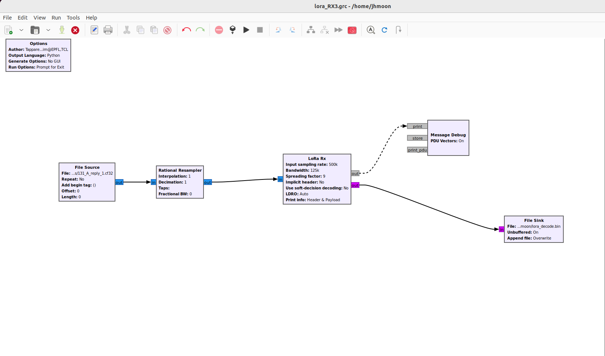

# 131-two-voices

| | |
|---|---|
| **Category** | 13 — Night Shift |
| **Points** | 100 |

## Description

Night shift, GaianSpace MOC. GAIAN-723 dropped off the telemetry console at 01:12 and has not come back. The pass schedule says it is overhead right now.

David Aroz is alone on the SOC desk. Mission control has gone home, and the on-call engineer isn't answering. The ground station modem says nothing is there, but the station's raw recorder never stops, and Aroz pulled the last forty seconds of the band.

The waterfall is not empty. There are two voices in it. One of them is GAIAN-723. The other one is not on any GaianSpace frequency plan, and it is talking to our satellite.

The old frequency sheet pinned above the desk still says 433.000 MHz.

Find out what GAIAN-723 answered when the stranger first called it.

**Flag format:** `GAIANSPACE{...}`

**Attachments:**

- `vela_band_0114.sigmf-data` — the band recorder's raw capture (too large to attach: download it from [Hugging Face](https://huggingface.co/datasets/GaianSpace/ctf-2026-130/tree/main/131))
- `vela_band_0114.sigmf-meta` — the recorder's metadata for that capture
- `desk_notes.md` — Aroz's notes from the same watch; they can be wrong

## Hints

Two hints were released during the event:

1. **Not the same accent** — The two voices do not sound alike. Whatever works for one will not work for the other.
2. **The sheet is older than the night** — Trust what the recording shows over what is pinned to the wall.

## Solution

### Analysis

The 01:14 recorder metadata describes a **ci8**, approximately **2 MS/s** band recording centered at **433.549995 MHz**. The old frequency sheet's 433.000 MHz is not a reliable downlink reference: the waterfall shows multiple transmissions, and the task is to identify the reply from GAIAN-723 after the unknown caller's first `HELLO`.

The target reply was isolated near **433.175 MHz**. `extract_ack.py` cuts the short A-band reply that follows each B-band telecommand out of the raw recording `vela_band_0114.sigmf-data`, translates 433.175 MHz to baseband and decimates 4:1, writing complex-float IQ at **500 kS/s** as `131_A_reply_1.cf32` … `131_A_reply_4.cf32`. The first of these, starting about 4.17 s into the capture, is the answer to the first `HELLO`. Copies of these extractions are archived in `scripts/131_A_replies/`; regenerating them with `extract_ack.py` gives byte-identical files.

**The original solution uses GNU Radio Companion and `gr-lora_sdr`.** The LoRa receiver parameters in `lora_RX.grc` are:

| Parameter | Value |
|---|---|
| Input | `131_A_reply_1.cf32` (complex float IQ) |
| Sample rate | 500,000 samples/s |
| Bandwidth | 125,000 Hz |
| Spreading factor | SF9 |
| Coding rate | 1 (4/5) |
| Header mode | Explicit |
| PHY CRC | Enabled |
| Sync word | `0x12` |

The receiver prints the decoded packet directly in the **GNU Radio execution window**. Its header checksum and payload CRC both pass; the message is an acknowledgement of the first `HELLO`:

```text
TM,ACK,0,HELLO,GAIANSPACE{tw0_v01c3s_0B0EFE1A}
```

The write-up includes `result.txt` as a historical record of this output. **`result.txt` was manually created by copying the text shown in the GNU Radio execution window.** It is **not** a text file automatically generated by GNU Radio or by the receiver flowgraph. The flowgraph also contains a separate binary File Sink (`131_decoded.bin`); this is not `result.txt`.

For independent confirmation, `131.py` performs offline LoRa decoding with NumPy/SciPy, checks the explicit-header checksum and PHY CRC, and prints the same payload and flag. The offline script is a **secondary verification method**, not a prerequisite for obtaining the flag from GNU Radio. It can decode the extracted IQ, or scan the raw SigMF recording and extract the reply itself.

### Reproduction

#### 0. Prepare the directory

As for every challenge in this repository, copy the solver and its helper scripts from `scripts/` into `challenges/` and work from there. Place the separately downloaded `vela_band_0114.sigmf-data` next to `vela_band_0114.sigmf-meta`.

```bash
cp scripts/* challenges/ 2>/dev/null
cd challenges
python3 -m pip install numpy scipy
```

#### 1. Extract the reply IQ (original workflow)

```bash
python3 extract_ack.py
```

```text
131_A_reply_1.cf32 240000 1920000
131_A_reply_2.cf32 275000 2200000
131_A_reply_3.cf32 200000 1600000
131_A_reply_4.cf32 225000 1800000
```

`extract_ack.py` uses fixed windows (4.17 s, 16.03 s, 28.47 s and 39.22 s from the capture start) measured on the waterfall. The flag only needs `131_A_reply_1.cf32`. `extract_followup.py` similarly cuts the later A-band candidate bursts, with wider 1.2 s windows, into `131_A_2.cf32` … `131_A_4.cf32`. They are not needed for the flag.

#### 2a. Decode with GNU Radio (original solution)

Install GNU Radio and a compatible build of the `gr-lora_sdr` out-of-tree receiver. For an Ubuntu system, GNU Radio itself can be installed with:

```bash
sudo apt update
sudo apt install -y gnuradio
```

Install/build [`gr-lora_sdr`](https://github.com/tapparelj/gr-lora_sdr) using the instructions for the **same GNU Radio/Python version** as the machine running GNU Radio Companion; this is not an ordinary `pip install` dependency.

1. Open `lora_RX.grc` in **GNU Radio Companion** from the `challenges/` directory.
2. Confirm that **File Source** reads `131_A_reply_1.cf32` (generated in step 1) with the **Complex** sample type, and that the LoRa RX block matches the settings above.
3. Generate and run the flowgraph. The corrected `lora_RX.py` supplied alongside the GRC is its Python implementation and can also be run in a compatible GNU Radio environment.
4. Read the LoRa decoder's text in the **GNU Radio execution/output window**. The flag appears directly in the received `TM,ACK,0,HELLO,...` message.



The relevant console output, **manually transcribed into the archived `result.txt`**, is:

```text
--------Header--------
Payload length: 46
CRC presence:   1
Coding rate:    1
Header checksum valid!

rx msg: TM,ACK,0,HELLO,GAIANSPACE{tw0_v01c3s_0B0EFE1A}
CRC valid!

******* MESSAGE DEBUG PRINT ********
TM,ACK,0,HELLO,GAIANSPACE{tw0_v01c3s_0B0EFE1A}
************************************
```

The successful header checksum and PHY CRC support the interpretation that this is a correctly decoded reply rather than a spurious LoRa synchronization event.

#### 2b. Decode with the standalone Python receiver (independent verification)

`131.py` does not require GNU Radio. With no argument it decodes `131_A_reply_1.cf32` from step 1:

```bash
python3 131.py
# equivalent: python3 131.py 131_A_reply_1.cf32
```

```text
Header checksum valid: True
Payload length: 46
PHY CRC: received=2E6F calculated=2E6F valid=True
PAYLOAD: TM,ACK,0,HELLO,GAIANSPACE{tw0_v01c3s_0B0EFE1A}
FLAG: GAIANSPACE{tw0_v01c3s_0B0EFE1A}
```

#### Alternative: decode straight from the raw recording

`131.py` can also skip step 1. Given the SigMF recording, it scans candidate bursts at 433.175 and 433.925 MHz, translates each to baseband, resamples to complex-float IQ, and accepts a reply only after the header checksum, the PHY CRC and the `TM,ACK,0,HELLO` structure all agree:

```bash
python3 131.py vela_band_0114.sigmf-data --save-extracted 131_reply_extracted.cf32
```

```text
SigMF: fs=1999999.0 Hz center=433549995.0 Hz duration=45.000 s
CHANNEL: 433175000 Hz, burst candidates=8
RECOVERED: channel=433175000 Hz interval=4.129..4.695 s
EXTRACTED IQ: 131_reply_extracted.cf32
Header checksum valid: True
Payload length: 46
PHY CRC: received=2E6F calculated=2E6F valid=True
PAYLOAD: TM,ACK,0,HELLO,GAIANSPACE{tw0_v01c3s_0B0EFE1A}
FLAG: GAIANSPACE{tw0_v01c3s_0B0EFE1A}
```

The automatically found interval (4.129–4.695 s) covers the same burst as the first `extract_ack.py` window. If needed, `--window START:STOP` specifies seconds relative to the capture start.

### Extraction Code

**`extract_ack.py`**

```python
#!/usr/bin/env python3
"""Extract short A-band transmissions after each B-band telecommand."""
from pathlib import Path
import numpy as np
from scipy.signal import resample_poly

root = Path(__file__).resolve().parent
fs = 1_999_999.0
center_hz = 433_549_995.0
signal_hz = 433_174_995.0
raw = np.memmap(root / 'vela_band_0114.sigmf-data', dtype=np.int8, mode='r')
windows = [(1, 4.17, 0.48), (2, 16.03, 0.55), (3, 28.47, 0.40), (4, 39.22, 0.45)]
for idx, start, duration in windows:
    lo = int(start * fs)
    hi = int((start + duration) * fs)
    i8 = np.asarray(raw[2 * lo:2 * hi], dtype=np.float32).reshape(-1, 2)
    iq = np.asarray(i8[:, 0] + 1j * i8[:, 1], dtype=np.complex64)
    n = np.arange(iq.size, dtype=np.float64)
    shift_hz = signal_hz - center_hz
    iq *= np.exp(-2j * np.pi * shift_hz * n / fs).astype(np.complex64)
    result = resample_poly(iq, 1, 4).astype(np.complex64)
    path = root / f'131_A_reply_{idx}.cf32'
    result.tofile(path)
    print(path.name, result.size, path.stat().st_size)
```


### Solver Code

**`131.py`**

```python
#!/usr/bin/env python3
# SPDX-License-Identifier: GPL-3.0-or-later
# Dependencies (Python >= 3.10):
#   python3 -m pip install numpy scipy
# GNU Radio is NOT required for this offline LoRa decoder.
# The LoRa bit layout follows the GPL-3.0 gr-lora_sdr implementation:
#   https://github.com/tapparelj/gr-lora_sdr
"""Recover Challenge 131 from extracted IQ or original ci8 SigMF capture.

Reproduction with archived extraction:
  python3 131.py 131_A_reply_1.cf32

Directly from the original large capture (when available):
  python3 131.py vela_band_0114.sigmf-data

Manual fallback for unexpected burst-detector settings:
  python3 131.py vela_band_0114.sigmf-data --window 12.0:14.0

The first packet is accepted only if the explicit header checksum, PHY CRC,
and the HELLO-ACK message structure agree. There is no embedded flag or packet.
"""
from __future__ import annotations

import argparse
import binascii
import math
from pathlib import Path
import re
import sys
from typing import Any

import numpy as np
from scipy import fft, signal

HAMMING = np.asarray([0, 23, 45, 58, 78, 89, 99, 116,
                      139, 156, 166, 177, 197, 210, 232, 255], dtype=np.int64)
HAMMING_45 = np.asarray([0, 24, 40, 48, 72, 80, 96, 120,
                         136, 144, 160, 184, 192, 216, 232, 240], dtype=np.int64)


def whitening(length: int) -> list[int]:
    state = 255
    result: list[int] = []
    for _ in range(int(length)):
        result.append(int(state))
        feedback = ((state >> 7) ^ (state >> 5) ^ (state >> 4) ^ (state >> 3)) & 1
        state = ((state << 1) & 255) | int(feedback)
    return result


WHITENING = whitening(512)


def ref_chirp(sf: int) -> np.ndarray:
    n = np.arange(1 << int(sf), dtype=np.float64)
    return np.exp(1j * np.pi * (n * n / float(1 << int(sf)) - n))


def measure(x: np.ndarray, start: float, sf: int, oversample: int = 4,
            cfo_bins: float = 0.0, fft_multiplier: int = 1,
            downchirp: bool = False) -> tuple[float, float]:
    size = int(1 << int(sf))
    indices = int(round(float(start))) + np.arange(size, dtype=np.int64) * int(oversample)
    if int(indices[0]) < 0 or int(indices[-1]) >= int(x.size):
        return -1.0, 0.0
    reference = ref_chirp(int(sf))
    correction = np.exp(-2j * np.pi * float(cfo_bins) * np.arange(size, dtype=np.float64) / float(size))
    y = x[indices] * (reference if downchirp else np.conj(reference)) * correction
    spectrum = np.abs(fft.fft(y, n=int(size * int(fft_multiplier)))) ** 2
    peak = int(np.argmax(spectrum))
    energy = float(np.sum(np.abs(y) ** 2)) * float(size)
    return float(peak) / float(fft_multiplier), float(spectrum[peak]) / (energy + 1e-30)


def synchronize(x: np.ndarray, sf: int, oversample: int = 4) -> dict[str, Any]:
    size = int(1 << int(sf))
    stride = int(size * int(oversample))
    grid = np.arange(0, int(x.size) - stride, stride, dtype=np.int64)
    measurements = np.asarray([measure(x, float(p), sf, oversample) for p in grid], dtype=np.float64)
    candidate = None
    for i in range(int(grid.size) - 3):
        delta = (measurements[i:i + 4, 0] - measurements[i, 0] + float(size) / 2.0) % float(size) - float(size) / 2.0
        if float(np.min(measurements[i:i + 4, 1])) > 0.20 and float(np.max(np.abs(delta))) <= 1.0:
            candidate = int(i)
            break
    if candidate is None:
        raise RuntimeError('No run of reference upchirps was detected.')
    down_index = None
    for j in range(candidate + 4, min(candidate + 40, int(grid.size) - 1)):
        a = measure(x, float(grid[j]), sf, oversample, downchirp=True)
        b = measure(x, float(grid[j + 1]), sf, oversample, downchirp=True)
        if a[1] > 0.18 and b[1] > 0.35:
            down_index = int(j)
            break
    if down_index is None:
        raise RuntimeError('A downchirp pair was not detected after the preamble.')
    p, d = int(grid[candidate]), int(grid[down_index])
    up_bin = measure(x, float(p + stride), sf, oversample, fft_multiplier=64)[0]
    down_bin = measure(x, float(d + stride), sf, oversample, fft_multiplier=64, downchirp=True)[0]
    up_signed = (up_bin + float(size) / 2.0) % float(size) - float(size) / 2.0
    down_signed = (down_bin + float(size) / 2.0) % float(size) - float(size) / 2.0
    coarse_cfo = (up_signed + down_signed) / 2.0
    correlation = np.vdot(x[p:p + 3 * stride], x[p + stride:p + 4 * stride])
    fractional_cfo = float(np.angle(correlation)) / (2.0 * np.pi)
    cfo = float(round(coarse_cfo - fractional_cfo)) + fractional_cfo
    timing_chips = (up_signed - down_signed) / 2.0
    down_start = float(d) - timing_chips * float(oversample)
    data_start = int(round(down_start + 2.25 * float(stride)))
    netids = [int(round(measure(x, down_start - float(k * stride), sf, oversample, cfo)[0])) for k in (2, 1)]
    return dict(data_start=data_start, down_start=down_start, cfo_bins=cfo, netids=netids)


def decode_block(symbols: np.ndarray, sf_effective: int, cr: int) -> tuple[list[int], list[int]]:
    labels = np.asarray(symbols, dtype=np.int64)
    gray = labels ^ (labels >> 1)
    width = int(cr + 4)
    bits = np.zeros((int(sf_effective), width), dtype=np.int64)
    for i in range(width):
        for j in range(int(sf_effective)):
            bits[(i - j - 1) % int(sf_effective), i] = (int(gray[i]) >> (int(sf_effective) - 1 - j)) & 1
    codewords = bits.dot(1 << np.arange(width - 1, -1, -1, dtype=np.int64))
    lut = (HAMMING_45 if int(cr) == 1 else HAMMING) >> (8 - width)
    nibbles: list[int] = []
    distances: list[int] = []
    for codeword in codewords:
        distance = [int(int(codeword) ^ int(entry)).bit_count() for entry in lut]
        index = int(np.argmin(np.asarray(distance, dtype=np.int64)))
        nibbles.append(int(f'{index:04b}'[::-1], 2))
        distances.append(int(distance[index]))
    return nibbles, distances


def header_info(nibbles: list[int]) -> dict[str, Any]:
    a, b, c, d, e = [int(v) for v in nibbles[:5]]
    bit = lambda value, index: (int(value) >> int(index)) & 1
    parity = [
        bit(a, 3) ^ bit(a, 2) ^ bit(a, 1) ^ bit(a, 0),
        bit(a, 3) ^ bit(b, 3) ^ bit(b, 2) ^ bit(b, 1) ^ bit(c, 0),
        bit(a, 2) ^ bit(b, 3) ^ bit(b, 0) ^ bit(c, 3) ^ bit(c, 1),
        bit(a, 1) ^ bit(b, 2) ^ bit(b, 0) ^ bit(c, 2) ^ bit(c, 1) ^ bit(c, 0),
        bit(a, 0) ^ bit(b, 1) ^ bit(c, 3) ^ bit(c, 2) ^ bit(c, 1) ^ bit(c, 0),
    ]
    calculated = int(''.join(str(int(v)) for v in parity), 2)
    received = int(((d & 1) << 4) | e)
    return dict(length=int((a << 4) | b), cr=int(c >> 1), has_crc=bool(c & 1),
                checksum_valid=bool(calculated == received and (d & 14) == 0),
                checksum_calculated=calculated, checksum_received=received)


def decode_explicit(symbols: list[int], sf: int) -> dict[str, Any] | None:
    values = np.asarray(symbols, dtype=np.int64)
    if int(values.size) < 8:
        return None
    modulus = int(1 << int(sf))
    nibbles, errors = decode_block(((values[:8] - 1) % modulus) // 4, int(sf) - 2, 4)
    header = header_info(nibbles)
    if not header['checksum_valid'] or not 1 <= int(header['cr']) <= 4:
        return None
    cr, length = int(header['cr']), int(header['length'])
    symbol_count = int(8 + math.ceil(float(8 * length - 4 * int(sf) + 28 + 16) / float(4 * int(sf))) * (cr + 4))
    values = values[:symbol_count]
    payload_nibbles = list(nibbles[5:])
    for i in range(8, int(values.size) - (cr + 4) + 1, cr + 4):
        block = (values[i:i + cr + 4] - 1) % modulus
        decoded, distance = decode_block(block, int(sf), cr)
        payload_nibbles.extend(decoded)
        errors.extend(distance)
    raw_bytes = bytes(int(payload_nibbles[i] | (payload_nibbles[i + 1] << 4))
                      for i in range(0, len(payload_nibbles) - 1, 2))
    if len(raw_bytes) < length + 2 or not bool(header['has_crc']):
        return None
    decoded_bytes = bytes(int(v) ^ int(WHITENING[i]) if i < length else int(v)
                          for i, v in enumerate(raw_bytes))
    payload = decoded_bytes[:length]
    received_crc = int.from_bytes(decoded_bytes[length:length + 2], byteorder='little')
    calculated_crc = int(binascii.crc_hqx(payload[:-2], 0) ^ int(payload[-1]) ^ (int(payload[-2]) << 8))
    symbol_count = int(8 + math.ceil(float(8 * length - 4 * int(sf) + 28 + 16) / float(4 * int(sf))) * (cr + 4))
    return dict(header=header, payload=payload, payload_hex=payload.hex(),
                crc_valid=bool(received_crc == calculated_crc),
                crc_calculated=f'{calculated_crc:04X}', crc_received=f'{received_crc:04X}',
                data_symbol_count=symbol_count, codeword_bit_distance_sum=int(sum(errors)))


def load_sigmf_info(data: Path, meta: Path | None) -> tuple[np.ndarray, float, float]:
    import json
    metadata = (meta or data.with_suffix('.sigmf-meta'))
    info = json.loads(metadata.read_text(encoding='utf-8'))
    if info['global']['core:datatype'] != 'ci8':
        raise ValueError('Only ci8 SigMF recordings are supported.')
    fs = float(info['global']['core:sample_rate'])
    center = float(info['captures'][0]['core:frequency'])
    samples = np.memmap(data, dtype=np.int8, mode='r')
    if samples.size % 2:
        raise ValueError('Incomplete IQ sample in capture.')
    return samples.reshape(-1, 2), fs, center


def extract_iq(raw: np.ndarray, fs: float, center: float, start: float,
               stop: float, channel_hz: float) -> np.ndarray:
    first = max(0, int(round(float(start) * float(fs))))
    last = min(int(raw.shape[0]), int(round(float(stop) * float(fs))))
    if last <= first:
        raise ValueError('Invalid extraction time window.')
    iq8 = np.asarray(raw[first:last], dtype=np.float32)
    iq = (iq8[:, 0] + 1j * iq8[:, 1]).astype(np.complex64)
    index = np.arange(int(iq.size), dtype=np.float64) + float(first)
    shift = np.exp(-2j * np.pi * (float(channel_hz) - float(center)) * index / float(fs))
    iq *= np.asarray(shift, dtype=np.complex64)
    # Narrow-band FIR anti-alias filter is part of resample_poly.
    return signal.resample_poly(iq, 1, 4, window=('kaiser', 8.0)).astype('<c8')


def detect_channel_bursts(raw: np.ndarray, fs: float, center: float,
                          channel_hz: float) -> list[tuple[float, float]]:
    # Scan short windows in the recorded band; no reference flag or known time is used.
    block = 16384
    total = int(raw.shape[0]) // block
    if total < 3:
        return []
    fft_freq = np.fft.fftfreq(block, 1.0 / float(fs))
    offset = float(channel_hz) - float(center)
    signal_bins = np.abs(fft_freq - offset) <= 68000.0
    reference_bins = (np.abs(fft_freq - offset) >= 145000.0) & (np.abs(fft_freq - offset) <= 240000.0)
    if not signal_bins.any() or not reference_bins.any():
        raise ValueError('Channel frequency is too close to recorder bandwidth edge.')
    scores = np.empty(total, dtype=np.float32)
    for index in range(total):
        segment = np.asarray(raw[index * block:(index + 1) * block], dtype=np.float32)
        spectrum = np.abs(np.fft.fft(segment[:, 0] + 1j * segment[:, 1])) ** 2
        p_signal = float(np.mean(spectrum[signal_bins]))
        p_noise = float(np.mean(spectrum[reference_bins]))
        scores[index] = float(p_signal / max(p_noise, 1e-12))
    # Relative spectral occupancy threshold; output is reviewed by PHY/application CRC.
    active = np.flatnonzero(scores > 4.0)
    if active.size == 0:
        return []
    delta = float(block) / float(fs)
    groups: list[list[int]] = [[int(active[0])]]
    for index in active[1:]:
        if int(index) - groups[-1][-1] <= max(1, int(round(0.12 / delta))):
            groups[-1].append(int(index))
        else:
            groups.append([int(index)])
    windows = []
    for group in groups:
        a = float(group[0]) * delta
        b = float(group[-1] + 1) * delta
        if b - a < 0.07:
            continue
        windows.append((max(0.0, a - 0.09), min(float(raw.shape[0]) / fs, b + 0.14)))
    return windows


def parse_window(value: str) -> tuple[float, float]:
    a, b = value.split(':', 1)
    start, stop = float(a), float(b)
    if not 0 <= start < stop:
        raise ValueError('Use --window START:STOP in seconds.')
    return start, stop


def decode_reply_iq(iq: np.ndarray) -> dict[str, Any] | None:
    sf, oversample = 9, 4
    try:
        sync = synchronize(iq, sf, oversample)
    except (ValueError, RuntimeError):
        return None
    stride = (1 << sf) * oversample
    for adjust in (0, -1, 1, -2, 2, -3, 3, -4, 4, -5, 5):
        first = int(sync['data_start']) + int(adjust)
        symbols = []
        for index in range(160):
            position = first + index * stride
            if position < 0 or position + stride > int(iq.size):
                break
            value, _quality = measure(iq, float(position), sf, oversample, float(sync['cfo_bins']))
            symbols.append(int(round(value)))
        packet = decode_explicit(symbols, sf)
        if packet is None or not bool(packet['crc_valid']):
            continue
        payload = bytes(packet['payload'])
        if not payload.startswith(b'TM,ACK,0,HELLO,'):
            continue
        packet['cfo_bins'] = float(sync['cfo_bins'])
        packet['sample_adjustment'] = int(adjust)
        return packet
    return None


def print_packet(packet: dict[str, Any]) -> None:
    payload = bytes(packet['payload'])
    text = payload.decode('ascii', errors='strict')
    print('Header checksum valid:', packet['header']['checksum_valid'])
    print('Payload length:', int(packet['header']['length']))
    print('PHY CRC: received=' + str(packet['crc_received']) +
          ' calculated=' + str(packet['crc_calculated']) +
          ' valid=' + str(bool(packet['crc_valid'])))
    print('PAYLOAD:', text)
    flag = re.search(r'GAIANSPACE\{[^{}]+\}', text)
    if flag is None:
        raise RuntimeError('ACK decoded with CRC, but no flag present.')
    print('FLAG:', flag.group(0))


def main() -> int:
    parser = argparse.ArgumentParser(description=__doc__)
    parser.add_argument('input', nargs='?', type=Path, default=Path('131_A_reply_1.cf32'))
    parser.add_argument('--meta', type=Path, default=None)
    parser.add_argument('--window', type=parse_window, default=None,
                        help='Optional manual time interval START:STOP in SigMF recording.')
    parser.add_argument('--frequency', type=float, nargs='+', default=[433175000.0, 433925000.0],
                        help='Candidate receiver channels in Hz, not encoded answers.')
    parser.add_argument('--max-bursts', type=int, default=80)
    parser.add_argument('--save-extracted', type=Path, default=None)
    args = parser.parse_args()
    if args.input.suffix.lower() == '.cf32':
        result = decode_reply_iq(np.fromfile(args.input, dtype='<c8'))
        if result is None:
            raise RuntimeError('No CRC-valid satellite HELLO reply in supplied IQ.')
        print_packet(result)
        return 0
    raw, fs, center = load_sigmf_info(args.input, args.meta)
    print(f'SigMF: fs={fs:.1f} Hz center={center:.1f} Hz duration={raw.shape[0] / fs:.3f} s', flush=True)
    tested = 0
    for frequency in args.frequency:
        windows = ([args.window] if args.window is not None
                   else detect_channel_bursts(raw, fs, center, float(frequency)))
        print(f'CHANNEL: {frequency:.0f} Hz, burst candidates={len(windows)}', flush=True)
        for start, stop in windows[:max(1, int(args.max_bursts))]:
            tested += 1
            iq = extract_iq(raw, fs, center, float(start), float(stop), float(frequency))
            result = decode_reply_iq(iq)
            if result is not None:
                print(f'RECOVERED: channel={frequency:.0f} Hz interval={start:.3f}..{stop:.3f} s')
                if args.save_extracted is not None:
                    iq.tofile(args.save_extracted)
                    print('EXTRACTED IQ:', args.save_extracted)
                print_packet(result)
                return 0
    raise RuntimeError(f'No valid satellite HELLO reply in {tested} tested candidate windows. '
                       'Use --window START:STOP or inspect the spectrum.')


if __name__ == '__main__':
    try:
        raise SystemExit(main())
    except (OSError, ValueError, RuntimeError) as exc:
        print('ERROR:', exc, file=sys.stderr)
        raise SystemExit(1)
```

## Flag

```text
GAIANSPACE{tw0_v01c3s_0B0EFE1A}
```
